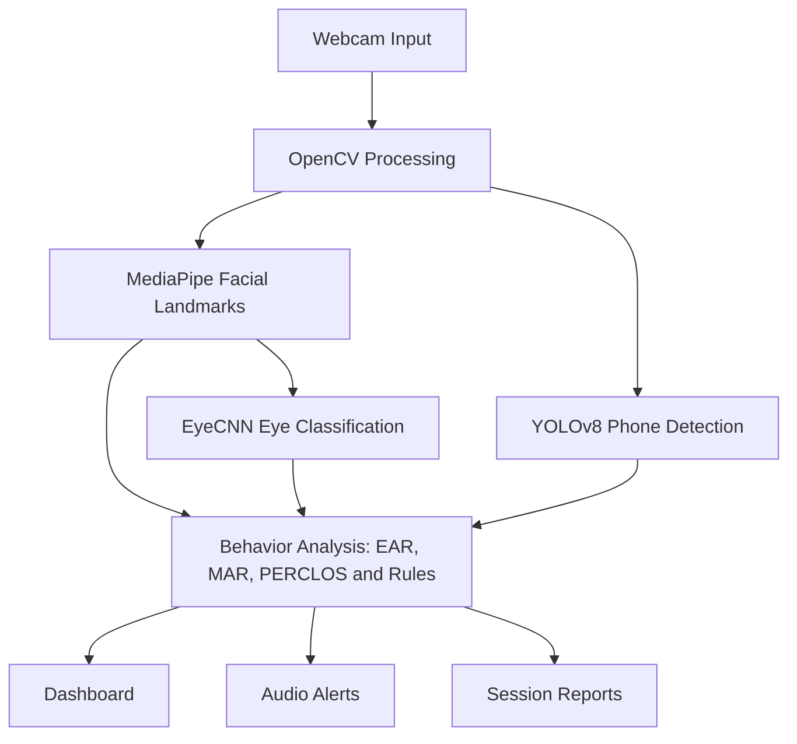
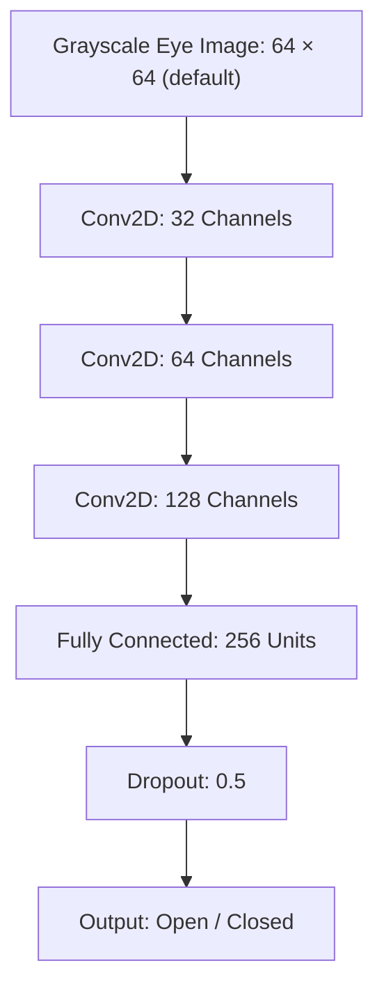

# Driver Monitoring System


## Project Overview

A real-time computer vision and deep learning prototype for monitoring driver fatigue, drowsiness, distraction, and mobile phone usage. The system integrates facial landmark analysis, CNN-based eye classification, object detection, and real-time alert mechanisms.

## Key Features

- **Drowsiness Detection:** Eye Aspect Ratio (EAR) and eye-state monitoring.
- **Distraction Detection:** Facial landmarks and head orientation analysis.
- **Mobile Phone Detection:** YOLOv8-based object detection.
- **Fatigue Monitoring:** PERCLOS-based eye closure analysis.
- **Yawn Detection:** Mouth Aspect Ratio (MAR) analysis.
- **Automatic Calibration:** Personalized eye closure thresholds.
- **Real-Time Alerts:** Visual and audible warning mechanisms.
- **Session Reporting:** Event logs, optional snapshots, and ZIP export.

## System Architecture



## Technical Components

| Component | Implementation |
|---|---|
| Video processing | OpenCV |
| Facial landmarks | MediaPipe Face Landmarker |
| Eye classification | PyTorch CNN |
| Object detection | YOLOv8n |
| Fatigue analysis | EAR and PERCLOS |
| Yawn detection | MAR |
| User interface | Streamlit |
| Audio warnings | Windows winsound |

## CNN Architecture



Convolutional blocks include batch normalization, ReLU activation, and max pooling.

## Repository Structure

```text
driver-monitoring-system/
├── web_app.py
├── surucu_takip.py
├── step1_kamera_test.py
├── eye_model.pt
├── yolov8n.pt
├── face_landmarker.task
├── requirements.txt
└── README.md
```

Session reports and optional snapshots are generated locally during execution.

## Installation & Usage

**Prerequisites:** Python, Windows, and a webcam.

```bash
git clone https://github.com/blgmstf332/driver-monitoring-system.git
cd driver-monitoring-system
pip install -r requirements.txt
```

Streamlit interface:

```bash
streamlit run web_app.py
```

Desktop monitoring:

```bash
python surucu_takip.py
```

Camera test:

```bash
python step1_kamera_test.py
```

## Runtime Monitoring

- Frames per second (FPS)
- Face detection rate
- CNN prediction confidence
- Personalized EAR threshold
- Average PERCLOS
- Detected events and session duration

Runtime statistics and prediction confidence are not substitutes for validated accuracy metrics.

## Limitations & Future Improvements

- Validate performance on an independent, labeled test dataset.
- Include model training scripts and reproducible evaluation.
- Improve detection under varying lighting conditions and camera angles.
- Standardize CNN integration across application versions.
- Add cross-platform camera and audio support.
- Pin dependency versions.
- Improve privacy and secure handling of captured images.

**Disclaimer:** This project is an educational prototype, not a certified automotive safety system. It must not be relied upon to determine whether a person is safe to drive.

## Author

**Mustafa Kılıç**

Computer Engineering Student — Artificial Intelligence, Machine Learning & Data Science

[GitHub](https://github.com/blgmstf332)
